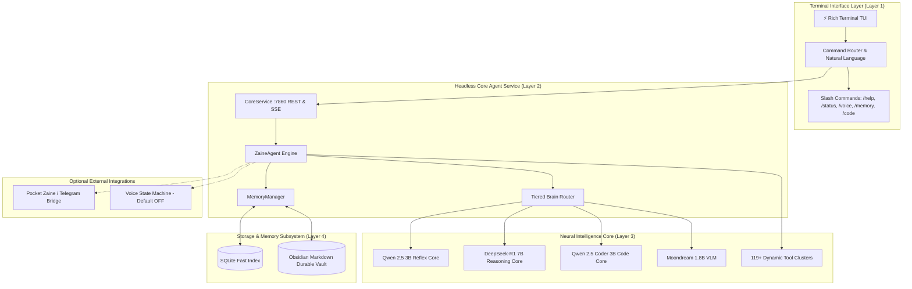

# ⚡ Z.A.I.N.E (Zero-latency Autonomous Intelligent Neural Entity)

<p align="center">
  
  
  
  
  
  
</p>

<p align="center">
  <b>A terminal-native, autonomous AI assistant & personal Jarvis operating locally on your workstation.</b><br>
  Engineered with zero mandatory cloud dependencies, local neural model orchestration, durable Obsidian knowledge memory, rich terminal CLI, and remote mobile execution via Telegram.
</p>

---

## 🌟 Overview

**Z.A.I.N.E** (*Zero-latency Autonomous Intelligent Neural Entity*) is a fully local, privacy-first, terminal-native AI agent. Operating directly inside your command-line environment, Zaine combines high-speed conversational reflexes, coding intelligence, system automation tools, an Obsidian-backed durable memory vault, and an optional Telegram remote bridge.

> [!NOTE]
> **Architectural Pivot:** As of v6.0, Z.A.I.N.E is **terminal/TUI-first**. The previous desktop/HTML HUD window phase has been deprecated and retired from the active product architecture. Voice conversation is **disabled by default** and strictly command-gated via `/voice on` and `/speak`.

---

## 🏛️ System Architecture



---

## 🧠 Neural Models & Subsystems

| Subsystem | Model / Technology | Execution Tier | Purpose |
| :--- | :--- | :--- | :--- |
| **Reflex Core** | `qwen2.5:3b` | GPU VRAM | Conversational reasoning, intent routing, persona |
| **Reasoning Core** | `deepseek-r1:7b` | GPU / RAM | Deep analytical thinking & multi-step problem solving |
| **Code Engine** | `qwen2.5-coder:3b` | GPU VRAM | Autonomous code synthesis, refactoring, workspace inspection |
| **Vision Perception** | `moondream:latest` (1.8B VLM) | GPU VRAM | Multimodal image diagnostics and desktop inspection |
| **Durable Memory** | SQLite + Obsidian Vault | Local Disk | Security-hardened long-term knowledge, preferences & lessons |
| **Tools Ecosystem** | 119+ Python Tools | Local Host | Filesystem, git, processes, automation, and system diagnostics |
| **Speech Engine** | Faster-Whisper + Piper-TTS | Local CPU | Explicit command-gated voice input & synthesis (`/voice on`) |

---

## 🚀 Key Capabilities

### 💻 1. Terminal-Native Agent Experience
- **Interactive Rich CLI:** Features real-time status bars (Persona, Brain, Tools, Voice state), formatted markdown output, and compact tool activity indicators.
- **Dual Personas:** Switch seamlessly between **Jarvis** (`Sir ❯`, polite, precise) and **Ultron** (`Creator ❯`, ruthless efficiency) via `/persona`.
- **Integrated Code Mode:** Synthesize code, run tests, and inspect workspace files directly using `/code`, `/run`, `/test`, and `/inspect`.

### 🛡️ 2. Obsidian Durable Memory Subsystem
- **Dual-Layer Architecture:** SQLite for sub-millisecond operational indexing, Obsidian Markdown vault for human-readable long-term durability.
- **Security Hardened:** Built-in `MemoryPolicy` with prompt injection filters, trust level gating, XML isolation boundaries, and idempotent migrations.
- **Vault Control:** Manage your knowledge vault directly from the CLI via `/memory stats`, `/memory list`, `/memory search`, `/memory add`, and `/memory archive`.

### 🎙️ 3. Command-Gated Voice System (Default OFF)
- **Zero Stealth Microphone Access:** Normal operation is 100% text-only. The microphone is never initialized on startup or during text requests.
- **Explicit Voice Commands:**
  - `/voice on` — Enable persistent voice synthesis.
  - `/voice off` — Return immediately to text-only mode.
  - `/voice status` — View voice engine and audio hardware readiness.
  - `/speak` — One-shot microphone interaction that responds vocally and reverts to text-only.

### 📱 4. Pocket Zaine (Remote Mobile Bridge)
- **Telegram Bot Integration:** Optional 24/7 background tunnel with pairing authorization.
- Remote telemetry, image analysis, system monitoring, and task execution from your phone.

---

## 🛠️ Quick Start (Seminar / New Setup)

### 1. Prerequisites
- **Python 3.10+** (Tested on Python 3.12, Windows 10/11 & Linux)
- [Ollama](https://ollama.com) installed and running.

Pull the models:
```bash
# 1. Essential Core Model (Ultra-fast, runs on 4GB VRAM / CPU):
ollama pull qwen2.5:3b

# 2. (Optional) Custom Z.A.I.N.E Persona:
ollama create zaine-fast-3b -f Modelfile.fast3b

# 3. Optional Extended Models:
ollama pull deepseek-r1:7b
ollama pull qwen2.5-coder:7b
ollama pull moondream
```

### 2. Installation
```bash
git clone https://github.com/hmohammedmateenullashariff-bit/Z.A.I.N.E.git
cd Z.A.I.N.E
python -m venv .venv
# Windows:
.\.venv\Scripts\activate
# Linux/macOS:
# source .venv/bin/activate
pip install -r requirements.txt
```

### 3. Environment Setup
```bash
cp .env.example .env
```
*(Optional: Configure your paths, Telegram bot token, or NVIDIA API key in `.env`).*

### 4. Running Z.A.I.N.E.

* **One-Click Fast Demo Mode (Recommended for Live Demos / 4GB VRAM):**
  ```cmd
  run_demo_fast.bat
  ```
* **Full Interactive Terminal (TUI):**
  ```cmd
  zaine.bat
  ```
* **Canonical Python Entrypoint:**
  ```bash
  python main.py
  ```

---

## ⌨️ Command Palette

| Command | Action |
| :--- | :--- |
| `/help` | Display interactive command palette |
| `/status` | View system, hardware, model, and network telemetry |
| `/voice [on\|off\|status]` | Manage explicit voice mode state |
| `/speak` | One-shot microphone query |
| `/persona [jarvis\|ultron]` | Switch persona protocol |
| `/memory [stats\|list\|search\|add\|archive]` | Inspect and manage Obsidian durable memory |
| `/code <prompt>` | Direct code synthesis via Qwen2.5-Coder |
| `/inspect <file>` | View workspace/project file with line numbers |
| `/run <file>` | Execute a Python script in workspace |
| `/test` | Execute automated unittest suite |
| `/files` | List workspace files |
| `/session` | View current session status |
| `/new` | Initialize clean session (preserves durable vault) |
| `/history` | View episodic memory summaries |
| `/clear` | Clear terminal display |
| `/exit`, `/quit` | Gracefully shut down Z.A.I.N.E |

---

## 📂 Project Structure

```text
├── agent.py                  # Core conversational agent logic & tool coordinator
├── core_service.py           # Layer 2 Headless Core Agent Service (REST/SSE on :7860)
├── main.py                   # Canonical application entrypoint
├── terminal_ui.py            # Layer 1 Terminal/TUI interactive user interface
├── core_router.py            # Tiered neural brain routing (Reflex, Reason, Code, Vision)
├── memory_manager.py         # Unified SQLite + Obsidian memory manager with MemoryPolicy
├── obsidian_adapter.py       # Obsidian durable Markdown vault interface
├── memory.py                 # SQLite operational memory & FTS5 search
├── voice.py                  # Explicit command-gated Voice State Machine (Faster-Whisper & Piper)
├── tool_clusters.py          # Dynamic tool clustering & prompt compressor
├── tools.py                  # 119+ local execution tools & hardware controllers
├── zaine_cascade.py          # Coding mode engine
├── telegram_bridge.py        # Remote mobile Telegram daemon
├── docs/                     # Production specifications & architectural migration records
│   ├── MIGRATION_CLI_TUI.md  # Architectural pivot record
│   └── ZAINE_PRODUCTION_SPECIFICATION.md
└── tests/
    ├── test_cli_architecture.py   # CLI decoupling & voice isolation tests (18 tests)
    └── test_memory_subsystem.py    # Memory security, migration & vault tests (27 tests)
---

## 🚀 Seminar Demo Mode (`ZAINE_DEMO=1`)
Set environment variable `ZAINE_DEMO=1` (default OFF) for low-latency live demonstrations.
This caps `num_predict` around 300, enforces concise answers, disables background reflection,
and keeps neural model weights permanently pinned in GPU VRAM (`keep_alive: -1`).

---

## 🛡️ Privacy & Security

Z.A.I.N.E is designed with privacy and sovereignty as foundational principles:
- **100% Offline AI Inference:** Neural weights run locally on your workstation via Ollama.
- **Strict Audio Isolation:** Microphone is physically closed by default and only engages upon explicit `/voice on` or `/speak` commands.
- **Memory Security Boundaries:** Sanitization and injection-checking on all long-term memory writes.

---

## 📜 License

Distributed under the [MIT License](LICENSE).
